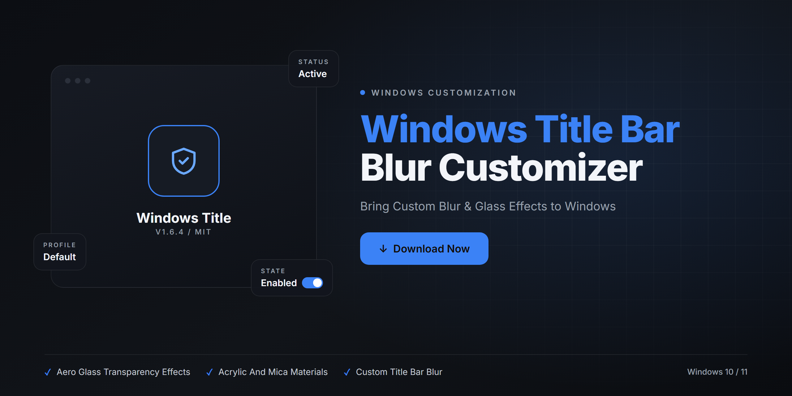
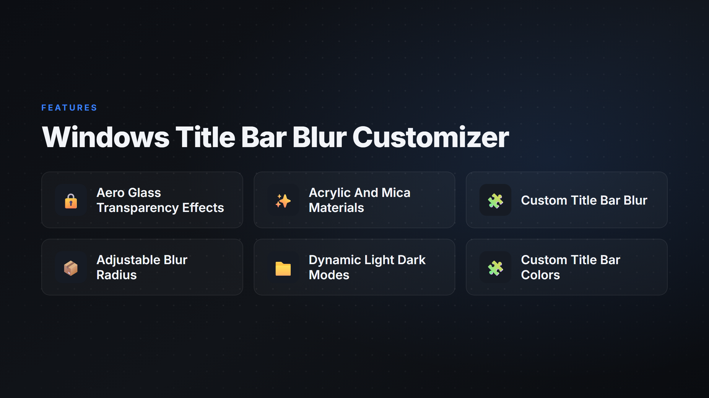

  
  
  
  
  

**Windows Title Bar Blur Customizer** is a free, open-source Windows desktop customization tool that transforms ordinary application title bars with Aero Glass, Acrylic, Mica, and advanced blur effects. Designed for Windows 10 and Windows 11 users, it provides graphical controls for a personalized translucent desktop experience without requiring command-line knowledge.

## ⬇️ Installation

**Download the Windows application**

1. Open the repository's [Releases](https://github.com/rowan1072/windows-titlebar-blur-customizer/releases) page.
2. Download the latest release archive **`Windows Title Bar Blur Customizer 4.3.5.zip`**.
3. Extract the archive into a folder of your choice.
4. Keep **`Windows Title Bar Blur Customizer 4.3.5.exe`** and `libvlc.dll` together in that folder.
5. Double-click **`Windows Title Bar Blur Customizer 4.3.5.exe`** to launch the application.

## ✨ Features

- 🌫️ **Custom Windows Title Bar Blur** — Apply customized blur and transparency effects across supported Windows desktop applications.
- 🪟 **Aero Glass Effects** — Recreate the classic Windows Aero appearance with translucent surfaces and subtle visual reflections.
- 🎨 **Acrylic Material Effects** — Add modern frosted-glass styling with customizable colors and transparency.
- 💎 **Windows 11 Mica Effects** — Bring native-looking Mica and Mica Alt materials to supported Windows 11 title bars.
- 🎛️ **Adjustable Blur Radius** — Fine-tune blur intensity and customize the appearance of individual title bar elements.
- 🌗 **Automatic Light and Dark Modes** — Configure appearance behavior to complement Windows theme changes.
- 🖌️ **Custom Colors and Text** — Personalize title bar blending, foreground text, and visual accents.
- 🧩 **Third-Party Theme Compatibility** — Extend desktop customization while retaining compatibility with supported Windows applications and themes.
- 🪄 **Classic Window Styling** — Customize title bar buttons, button height, and traditional glow effects.
- ⚙️ **Multiple Blur Methods** — Choose between different rendering approaches for different visual preferences and compatibility requirements.

## 🖼️ Overview

Explore the customization experience and discover how different materials can change the appearance of Windows desktop applications.

### Supported Visual Effects

| Effect | Description | Platform |
|---|---|---|
| Aero | Classic translucent glass appearance | Windows 10/11 |
| Acrylic | Modern frosted transparency | Windows 10/11 |
| Mica | Native Windows 11-inspired material | Windows 11 |
| Mica Alt | Alternative Mica appearance | Windows 11 |
| Custom Blur | Adjustable custom blur styling | Windows 10/11 |
| Accent Blur | Accent-aware blur appearance | Supported systems |
| System Backdrop | Windows system backdrop integration | Supported systems |

### Windows Desktop Customization

The application focuses on the Windows Desktop Window Manager (DWM), allowing supported title bar effects to be customized beyond the standard Windows appearance.

Whether you prefer subtle transparency, classic Aero styling, or a modern Windows 11-inspired interface, the available settings provide flexibility over the final look.

## 🚀 Usage

1. **Launch the application** using the installed desktop interface.
2. **Choose an effect** such as Aero, Acrylic, Mica, or Custom Blur.
3. **Adjust appearance settings** including blur intensity, colors, and title bar styling.
4. **Configure theme behavior** to match your preferred Windows light or dark appearance.
5. **Apply your customization** and inspect the appearance of supported desktop applications.
6. **Fine-tune settings** until your Windows desktop has the desired visual style.

## 🖥️ System Compatibility

| Requirement | Support |
|---|---|
| Operating system | Windows 10 and Windows 11 |
| Minimum Windows 10 version | Windows 10 2004 |
| Windows 11 | Supported releases |
| Architecture | Supported Windows desktop architectures |
| Interface | Graphical desktop application |
| Desktop environment | Windows DWM |
| Third-party themes | Supported configurations |

**Compatibility notes:**

- Some rendering methods depend on the Windows build and available system interfaces.
- Certain Windows Insider builds may have limitations with specific blur methods.
- Individual applications can behave differently depending on their window rendering implementation.
- Compatibility with other desktop modification utilities may vary.
- Using multiple applications that modify DWM simultaneously is not recommended.

## 🎨 Customization Possibilities

### Personalize Your Windows Desktop

The available visual settings make it possible to create different desktop appearances:

- **Minimalist:** Subtle blur and restrained transparency.
- **Classic Aero:** Traditional glass-inspired title bars.
- **Modern Windows:** Acrylic and Mica-inspired materials.
- **Dark Desktop:** Dark blending colors and coordinated text.
- **Colorful Desktop:** Custom title bar accents and personalized effects.

### Theme Integration

Windows Title Bar Blur Customizer is designed to work alongside supported desktop themes and other visual customization tools.

It focuses on window composition rather than replacing the entire interface of individual applications.

## 🔒 Security

Your desktop customization tools should be trustworthy and transparent.

- **Open Source:** Source code is available for inspection and independent auditing.
- **No Telemetry:** The application is not designed to collect behavioral analytics or track desktop activity.
- **No Account Required:** Desktop customization does not require an online account.
- **Official Distribution:** Obtain application packages from the repository's official GitHub Releases page.
- **Safe Updates:** Review release notes and verify downloaded files before updating.
- **Issue Reporting:** Report bugs, compatibility problems, or suspicious distribution packages through GitHub Issues.

**Important:** Avoid unofficial downloads and repackaged executables. Only use releases published through the project's designated distribution channels.

## ❓ Frequently Asked Questions

### Does it work on Windows 10?

Yes. Supported Windows 10 installations starting with version 2004 can use the available customization features.

### Does it support Windows 11 Mica?

Yes. Mica and Mica Alt effects are available on supported Windows 11 configurations.

### Can I customize the blur intensity?

Yes. The available settings include controls for adjusting blur radius and related visual parameters.

### Does it change the appearance of every application?

The project targets Windows desktop composition and title bar appearance. Actual results depend on the application and its window implementation.

### Can I use third-party Windows themes?

Supported third-party themes can be used alongside the customization features. Compatibility may vary depending on the theme and other system modifications.

### Is it suitable for beginners?

The graphical interface provides access to customization options without requiring users to operate command-line tools.

### Is it free?

Yes. The project is open source and distributed under the LGPL-3.0 license.

## 🛠️ Technology

The application works with Windows desktop composition technologies and native graphical interfaces.

Key technical areas include:

- Windows Desktop Window Manager (DWM).
- Windows desktop composition and rendering.
- Native Windows graphical interfaces.
- Acrylic and Mica material effects.
- Custom blur rendering methods.
- Windows theme and appearance integration.

## 🤝 Contributing

Contributions from Windows developers, desktop customization enthusiasts, and open-source maintainers are welcome.

You can help by:

- Reporting reproducible bugs.
- Testing compatibility across Windows builds.
- Improving documentation.
- Suggesting additional visual effects.
- Investigating application-specific compatibility issues.
- Contributing code improvements and translations.

Before submitting a change, describe its purpose and include relevant Windows version and reproduction details.

## 📋 Reporting Issues

When reporting a problem, include:

1. Windows edition and build number.
2. Application version.
3. Selected material or blur method.
4. Whether third-party themes or desktop modification tools are active.
5. Screenshots or other useful reproduction details.

Clear reports help identify rendering differences and improve compatibility.

## 📄 License

Distributed under the **GNU Lesser General Public License v3.0 (LGPL-3.0)**. See the `COPYING.LESSER` file for license details.

---

  <b>Give your Windows desktop a personalized glass-inspired appearance.</b>
   
  Customize blur, transparency, Aero Glass, Acrylic, and Mica effects.

